# Awesome-Data-Centric-AI-Data-Quality-Curation

  

# 🎯 Awesome Data-Centric AI & Data Quality Curation

### *A Curated Directory of SaaS Platforms & Open-Source Tools for Label Error Detection, Data Curation, and Self-Hosted Quality Scoring*

  
  
  
  
  
  

**Explore enterprise SaaS platforms, foundational Python libraries, and active learning engines to clean training datasets, detect label errors, remove out-of-distribution outliers, and automate weak supervision.**

---

## 📑 Table of Contents

- [🌐 Sector Overview & Market Dynamics](#-sector-overview--market-dynamics)
- [☁️ SaaS/Hosted Platforms](#-saashosted-platforms)
- [💻 Open-Source GitHub Projects](#-open-source-github-projects)
- [🛠️ Frameworks for Building Custom Systems](#-frameworks-for-building-custom-systems)
- [🤝 How to Contribute](#-how-to-contribute)
- [☕ Support](#-support)
- [📈 Star History](#-star-history)
- [⚠️ Disclaimer](#-disclaimer)

---

## 🌐 Sector Overview & Market Dynamics

The global AI Data Management and Data Quality market is valued between **$25.5B and $45B** and is projected to surpass **$100B by 2030** at a compound annual growth rate (**CAGR**) of over **20% to 22%**, driven by the imperative need for clean training tokens and multimodal data curation for foundation models. The market remains **moderately to highly fragmented** rather than winner-take-all, featuring dynamic competition among specialized programmatic labeling vendors, multimodal curation startups, automated data-cleaning libraries, and established cloud hyperscalers converging on enterprise lakehouses.

---

## ☁️ SaaS/Hosted Platforms

The following table benchmarks category-leading Data-Centric AI and data curation SaaS platforms. Companies are sorted in descending order of size by private valuation and annualized revenue scale.

| Platform | Company Valuation / Revenue Scale | Specific Starting Price | Free Tier / Trial Limits | Core Focus & Data Modalities |
| :--- | :--- | :--- | :--- | :--- |
| **[Snorkel Flow](https://snorkel.ai/)** | **$3.5B Valuation** (~$375M ARR; $580M+ total funding) | **$50,000/year** (Enterprise hosted application starting contract) | **No self-serve free tier** (Custom POC trial upon enterprise qualification) | Programmatic weak supervision, enterprise foundation model fine-tuning, complex NLP & structured data. |
| **[Labelbox](https://labelbox.com/)** | **$1.25B Valuation** ($289M+ total funding raised) | **$0.10 / LBU** (Starter Tier usage-based pay-as-you-go) | **Free Forever**: 500 LBUs/month, up to 30 users, 50 projects, 10M data rows, 25 ontologies, 1,500 req/min | Multimodal catalog, model-assisted annotation (SAM 2), human-in-the-loop QA pipelines, and LLM evaluation. |
| **[Encord](https://encord.com/)** | **~$350M–$450M Est. Valuation** ($110M funding; $60M Series C in Feb 2026) | **~$120/seat/month** (Team tier starting plan; custom Enterprise quotes) | **Free Starter Tier**: Up to 5 users, limited active annotation volume & community pipeline access | Multimodal AI data platform, active learning, Encord Active curation, DICOM/medical imaging, and RLHF. |
| **[V7 (Darwin / Go)](https://www.v7labs.com/)** | **~$100M Valuation** ($33M Series B; $41M+ total funding) | **£150 (~$190)/user/month** (Darwin Business Tier starting plan) | **14-day Free Trial** (Includes full Darwin platform features and sample automated computer vision workflows) | High-precision computer vision annotation, V7 Go document agentic OCR, and native DICOM/NIfTI medical imaging. |
| **[SuperAnnotate](https://www.superannotate.com/)** | **~$80M–$120M Est. Valuation** ($68.6M total funding; $50M Series B) | **Custom annual contract** (~$250–$300/user/month equiv. Starter tier) | **Free Tier**: Up to 3–5 users and 1,000 Orchestrate compute hours for automated pipelines | Computer vision & multimodal active learning, magnetic polygon segmentation, and multi-level QA workforce management. |
| **[Cleanlab Studio](https://cleanlab.ai/studio/)** | **~$70M–$100M Est. Valuation** ($30M total funding; $25M Series A) | **$0.002/row processed** ($50–$100/month pay-as-you-go starting tier) | **Free Account**: Complimentary starter credits (~1,000 data rows / introductory TLM queries) | Automated no-code label error detection, dataset auditing, outlier discovery, and Trustworthy Language Model (TLM) scoring. |

---

## 💻 Open-Source GitHub Projects

Explore the most popular open-source libraries for self-hosted data quality validation, automated label error identification, programmatic weak supervision, and LLM corpus curation. Sorted in descending order by GitHub Stars ⭐.

| Repository | Stars | License | Primary Capabilities & Best For |
| :--- | :--- | :--- | :--- |
| **[roboflow/supervision](https://github.com/roboflow/supervision)** |  | `Apache-2.0` | Comprehensive computer vision utility library: dataset loaders, visual format conversions, detections filtering, and active evaluation. |
| **[great-expectations/great_expectations](https://github.com/great-expectations/great_expectations)** |  | `Apache-2.0` | The leading standard for data quality testing, automated profiling, dataset validation pipelines, and production data documentation. |
| **[cleanlab/cleanlab](https://github.com/cleanlab/cleanlab)** |  | `Apache-2.0` | Standard library for automated label error detection, outlier extraction, duplicate removal, and training robust models with `CleanLearning`. |
| **[evidentlyai/evidently](https://github.com/evidentlyai/evidently)** |  | `Apache-2.0` | Open-source MLOps and LLM evaluation platform for dataset drift detection, data quality monitoring, and regression test suites. |
| **[datajuicer/data-juicer](https://github.com/datajuicer/data-juicer)** |  | `Apache-2.0` | One-stop multi-modal data processing suite for foundation models: 100+ operators for filtering, deduplication, quality scoring, and synthesis. |
| **[snorkel-team/snorkel](https://github.com/snorkel-team/snorkel)** |  | `Apache-2.0` | Landmark framework for programmatic weak supervision; write labeling functions (rules, heuristics) and combine them into probabilistic training labels. |
| **[argilla-io/argilla](https://github.com/argilla-io/argilla)** |  | `Apache-2.0` | Human-in-the-loop and feedback curation platform for LLM alignment, preference tuning (RLHF/DPO), and programmatic text annotation. |
| **[whylabs/whylogs](https://github.com/whylabs/whylogs)** |  | `Apache-2.0` | Lightweight statistical profiling library enabling mathematical logging of tabular, text, and multimodal data distribution shifts. |
| **[autodistill/autodistill](https://github.com/autodistill/autodistill)** |  | `Apache-2.0` | Uses large vision foundation models to automatically label training datasets and distill them into lightweight, production-ready edge models. |
| **[visual-layer/fastdup](https://github.com/visual-layer/fastdup)** |  | `Custom Free` | High-performance C++ engine for image and video data curation: detects duplicates, blurriness, dark images, outliers, and wrong annotations. |
| **[capitalone/DataProfiler](https://github.com/capitalone/DataProfiler)** |  | `Apache-2.0` | Automated data profiling toolkit to identify schema structures, statistical profiles, and sensitive/PII data across structured and unstructured datasets. |
| **[ChenghaoMou/text-dedup](https://github.com/ChenghaoMou/text-dedup)** |  | `Apache-2.0` | Production text deduplication algorithms (Exact Match, MinHash, SimHash, Bloom Filters) optimized for massive pretraining corpora. |
| **[Babelscape/skweak](https://github.com/Babelscape/skweak)** |  | `MIT` | Python toolkit for weak supervision specialized in NLP and named entity recognition (NER), applying Hidden Markov Models over noisy annotators. |
| **[JieyuZ2/wrench](https://github.com/JieyuZ2/wrench)** |  | `Apache-2.0` | Benchmark platform and toolkit for weak supervision, comparing generative label aggregators and end-to-end classification algorithms. |

---

## 🛠️ Frameworks for Building Custom Systems

When designing an in-house enterprise data-centric AI pipeline, modern engineering teams combine modular open-source components:

- **Auditing & Label Cleansing**: Use [cleanlab](https://github.com/cleanlab/cleanlab) to inspect model predictions, compute label confidence metrics, and identify corrupted training targets before training.
- **Weak Supervision & Dataset Bootstrapping**: Implement [snorkel](https://github.com/snorkel-team/snorkel) or [skweak](https://github.com/Babelscape/skweak) when expert labels are unavailable and domain heuristics can generate training priors.
- **Quality Guardrails & Schema Contracts**: Deploy [great_expectations](https://github.com/great-expectations/great_expectations) and [whylogs](https://github.com/whylabs/whylogs) to block downstream pipeline execution when incoming feature distributions degrade.
- **Pretraining & Multi-Modal Curation**: Leverage [data-juicer](https://github.com/datajuicer/data-juicer), [fastdup](https://github.com/visual-layer/fastdup), and [text-dedup](https://github.com/ChenghaoMou/text-dedup) to filter noise, duplicates, and artifacts at multi-gigabyte scale.
- **Human-in-the-Loop Feedback**: Deploy [argilla](https://github.com/argilla-io/argilla) for expert-in-the-loop review queues, RLHF feedback, and active dataset curation.

---

## 🤝 How to Contribute

Contributions from researchers, data engineers, and maintainers are warmly welcome!

1. 🍴 **Fork** this repository.
2. 🌿 Create a new branch: `git checkout -b feature/add-new-tool`.
3. 📝 Add your entry to `README.md` following the tabular format (including valid links, pricing, free tier limits, star badges, and factual descriptions).
4. 🚀 Push your branch and open a Pull Request.

---

## ☕ Support

If you found this curated list helpful for your machine learning workflows or dataset curation pipelines, please consider supporting the project:

- ⭐ **Star** this repository to help others discover it.
- 🍴 **Fork** and share it with your data science peers.
- ☕ **Sponsor the Maintainer**: Support ongoing curation, open-source benchmarks, and developer tools via the [GitHub Sponsors Dashboard](https://github.com/sponsors/ishandutta2007).

---

## 📈 Star History

---

## ⚠️ Disclaimer

- This repository is a **community-curated index** and is not officially affiliated with or endorsed by any vendor mentioned.
- Data curation tools process training datasets that may contain sensitive, personal, or proprietary records. Always ensure adequate data governance, review third-party privacy terms, and enforce VPC encryption when evaluating hosted SaaS products.
- Tool selection should follow specific engineering needs: **Cleanlab** specializes in discovering errors in existing labeled data; **Snorkel** specializes in programmatic synthesis when manual labels are lacking; and end-to-end suites like **Labelbox** and **Encord** combine annotation workforces with active dataset curation.

---

  Maintained with ❤️ by <a href="https://github.com/ishandutta2007">Ishan Dutta</a> and the global open-source AI community.

